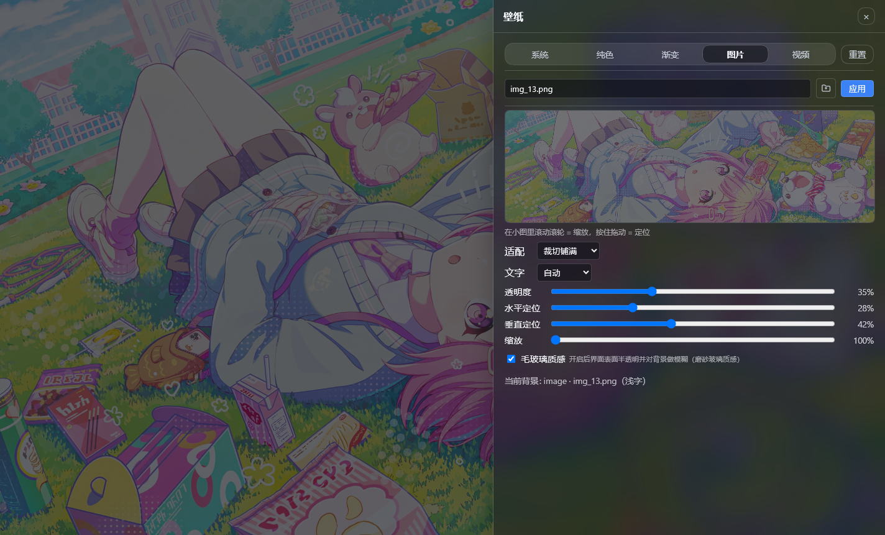

# dsh-bg-new



DSH（DeepSeek Harness）网页界面换背景插件：点左侧栏（Settings 上方）的**「壁纸」按钮**，右侧弹出抽屉，可换**系统预设 / 纯色 / 渐变 / 图片 / 视频**五种背景，滚轮 + 拖动的小图同时管缩放与定位，可选毛玻璃质感。桌面端**即时生效**、无需刷新，重启后仍在。

也可以直接对模型说「把背景换成深蓝」「用这张图做壁纸」，由 `bg_apply` 工具完成。

> 非官方社区插件，MIT。逐版变更见 [CHANGELOG.md](./CHANGELOG.md)。

## 功能

- 🎨 **五种背景**：系统预设 / 纯色 / 渐变 / 图片 / 视频（本地文件或远程链接）
- 🗂️ **侧栏入口 + 右侧抽屉**：不用进设置页；抽屉打开时自动收起左侧栏与聊天区并降透明，专注调参，点抽屉外即关闭
- 🖱️ **小图同时管缩放与定位**：滚轮缩放、拖动定位；指针拖到小图外有 2 秒宽限，超时才释放
- 📐 **适配与焦点**：fill / cover / contain 等 5 种适配，水平与垂直焦点可调，另有自由缩放与放大聚焦
- 🪟 **毛玻璃质感**：可选让面板、气泡、输入框变成半透明磨砂表面
- 🎞️ **动态壁纸**：本地 MP4 循环播放，可静音、可调音量；**视频不设体积上限**
- 🤖 **模型也能换**：`bg_apply` 工具支持颜色 / 渐变 / 图片 / 视频 / 本地文件 / 关闭
- 🌗 **文字方案**：按背景亮度自动推断，也可手动指定亮 / 暗文字方案
- 🔒 **媒体只在本机**：上传的图片与视频保存在本机数据目录，由插件自己的路由伺服（支持 Range，视频可拖动进度），**不会上传到任何云端服务**

## 兼容性（DSH 0.1.x / 0.2.x）

v0.8.0 起**同一份产物同时支持两代宿主**，插件在运行时自己挑通道：

| | DSH 0.1.x（如 `dsh web` 0.1.2-rc.1） | DSH 0.2.x（如桌面端 0.2.1-rc.2） |
| --- | --- | --- |
| 设置通道 | settings 命名空间 `dsh-bg-new`（宿主 `settings.register`） | 插件 entry 的 `Config`（字段全部 `.volatile()`），客户端按 entry id 取 `configForms.get('dsh-bg-new')` |
| 背景值存哪 | `$DSH_HOME/settings.yaml` 的 `dsh-bg-new:` 段 | 该 profile 的 `cordis.patch.yml` 里 `dsh-bg-new` 条目的 `config` |
| 宿主写回 | `scope.update(patch)` | `ctx.configEditor.edit(entry, fn)` |
| 降级兜底 | 无 settings provider 时写 `$DSH_HOME/dsh-bg-new/state.json` | 没有 `configEditor`（headless 等）时同左 |

判定全在运行时完成（`apply` 第二参是否为 volatile 引用、有没有 `configEditor`），所以升级 DSH 不需要换插件版本。

> 0.2.x 的宿主会把插件的 `peerDependencies`（`@deepseek-ai/schemastery`、`@deepseek-ai/dsh-tools`、`@deepseek-ai/dsh-home-paths`）解析到**运行时自带那一份**；插件目录里自带的 `node_modules/` 只服务 0.1.x。**别为了"省依赖"删掉它** —— 0.1.x 上没有运行时重定向，删了会 `Cannot find package`。

如果桌面端之前因为插件起不来（报 `web boot: 1 entry did not activate`），那是 v0.7.0 硬等已被 0.2.x 移除的 `settingsScope` 所致，升到 v0.8.0 即可；应急可在崩溃对话框里点「禁用第三方插件、备份 profile patch 并重启」。

## 安装

前置：已装好 DSH（`dsh web` 能正常运行）。

### 方式一：git 通道（推荐）

```sh
dsh plugin --profile web add github:sz1698/dsh-bg-new
```

装完**重启应用**（或重启 `dsh web`），再刷新浏览器。

> 桌面端（DeepSeek Harness Desktop，DSH 0.2.x）用的是 `desktop` profile：把命令里的 `--profile web` 换成 `--profile desktop`。

`dsh` 不在 PATH 时：

```sh
npx -y --package @deepseek-ai/dsh dsh plugin --profile web add github:sz1698/dsh-bg-new
```

仓库里已提交构建产物（`lib/client.js` 与 `lib/index.js`），安装时**不需要任何构建授权** —— pnpm 不会要求你写 `allowBuilds`。

> 注意：npm 上的 `dsh-bg` 是**另一个作者的同类插件**，与本项目无关，别装错；本项目目前**没有发布到 npm**，请用上面的 git 通道。

### 方式二：本地 clone（开发 / 自用）

```sh
git clone https://github.com/sz1698/dsh-bg-new.git
cd dsh-bg-new
npm install && npm run build
dsh plugin --profile web add .
```

国内镜像：<https://gitee.com/iuniko/dsh-bg/tree/main>

### 装完确认

```sh
dsh --profile web --dump-config     # 应能看到 "# == dsh-bg-new" 这一层
```

## 更新

装了之后想升到最新版，在**任何目录**执行：

```sh
dsh plugin --profile web update dsh-bg-new
```

然后**重启应用**（或重启 `dsh web`），再刷新浏览器 —— 客户端那一半要等重启后才会换成新版本；浏览器如果还显示旧界面，硬刷新一次（`Ctrl+Shift+R`）。

两点说明：

- 走 git 通道安装时按**提交**解析，不依赖版本号：上游有新提交，`update` 就会拉到最新的那一个（已实测）。
- 仓库里已提交构建产物，所以**更新同样不需要构建授权**，pnpm 不会要求你写 `allowBuilds`。

## 卸载

```sh
dsh plugin --profile web remove dsh-bg-new
```

## 许可

[MIT](./LICENSE)
